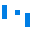

#  react-pong

[](https://github.com/jasondecamp/react-pong/actions/workflows/ci.yml)

Retro Pong you can embed: a framework-free Pong engine, plus a composite React component (`<Pong>`) that drops a playfield into any React app.

Play it in the [playground](https://jasondecamp.github.io/react-pong/).

- You play the right paddle against an AI on the left, at three difficulties. First to 11 wins, and whoever scores serves next.
- A good guest on the host page: keys are heard only while the court has focus, nothing is global, any number of games can share a page, and unmounting releases everything.
- Delta-time physics: the same speed at 60Hz and 120Hz, and a fast ball can't tunnel through a paddle.
- A ball with a speed and an angle: serves leave at a steady pace, each paddle hit adds 5%, a moving paddle drags the ball its own way, and the corners of a paddle send it off steeply.
- 8-bit blips synthesized with Web Audio. No asset files.
- The loop idles whenever nothing moves: between points, paused, game over, or offscreen.

## Install

Releases are git tags with the built files, installed straight from GitHub:

```bash
pnpm add github:jasondecamp/react-pong#semver:^0.1.0
# or pin one release: github:jasondecamp/react-pong#v0.1.0
```

`#main` and commit installs don't work: only release tags contain `dist/`. React (>= 19) is an optional peer dependency, needed only for the React entry point.

## React

```jsx
import { Pong } from 'react-pong';
import 'react-pong/styles.css';

<div className='arcade'>  {/* give it a size */}
  <Pong smack />
</div>
```

`<Pong>` fills its parent, so size the parent. Import the stylesheet once, anywhere.

### Controls

Click the court (or tab to it) to give it the keyboard. Keys the game handles don't scroll the page; every other key passes through.

| Key | |
| --- | --- |
| Up, Down | Move your paddle. It speeds up the longer you hold. |
| Enter | Serve. |
| Esc | Pause and resume. After game over, reset. |

A rally pauses by itself when the court loses focus, the tab is hidden, or the court scrolls offscreen.

### Composition

`<Pong>` is a composite: its parts are subcomponents you arrange as children. A bare `<Pong />` is this arrangement:

```jsx
<Pong>
  <Pong.Court />
  <Pong.Score />
  <Pong.Message />
</Pong>
```

Leave a part out, reorder them, or add your own. Custom parts read the game through `usePongGame()`:

```jsx
import { Pong, usePongGame } from 'react-pong';

const ServeButton = () => {
  const { phase, serve } = usePongGame();
  if (phase !== 'start' && phase !== 'between') return null;
  return <button type='button' onClick={() => serve()}>Serve</button>;
};

<Pong>
  <Pong.Court />
  <Pong.Score />
  <ServeButton />
</Pong>
```

| Part | Props | |
| --- | --- | --- |
| `<Pong>` | every [option](#options), `className`, `children` | Creates the game and provides it to its parts. Options are live: change a prop and only that option updates. |
| `<Pong.Court>` | `className`, `aria-label`, `autoFocus` | The focusable playfield with the ball and paddles. `autoFocus` focuses it on mount, for pages the game owns. |
| `<Pong.Score>` | `className` | The two scores, AI on the left. The winner's scales up. |
| `<Pong.Message>` | `className` | The start, pause, game over, and smack-talk copy. Smack talk fades after 5 seconds, and no line repeats within a match. For your own copy, replace it with a part of your own. |

`usePongGame()` returns the state below plus `serve()`, `pause()`, `resume()`, and `reset()`. It re-renders only when the score, phase, or message changes, never per frame.

| State | |
| --- | --- |
| `phase` | `'start'`, `'rally'`, `'paused'`, `'between'` (a point was scored; waiting for a serve), or `'gameOver'`. |
| `scores` | `{ left, right }`. |
| `winner` | `'left'`, `'right'`, or `null` until the game is over. |
| `message` | A key, not text: `'start'`, `'smack.ai'` (the AI scored), `'smack.human'`, `'paused'`, `'gameOver'`, `'reset'` (Enter was pressed after game over), or `null`. |
| `messageCount` | How many messages with this key came earlier in this match. |
| `matchRoll` | A random number in [0, 1) drawn at the start of each match. With `messageCount`, it lets your own copy be dealt from a deck shuffled once per match. |

`<Pong>` renders the start screen on the server and starts the game in an effect.

## Core (no framework)

```js
import { createPong } from 'react-pong/core';
import 'react-pong/styles.css';

const pong = createPong({
  court: document.querySelector('.pong-court'),
  ball: document.querySelector('.pong-ball'),
  leftPaddle: document.querySelector('.pong-paddle-left'),
  rightPaddle: document.querySelector('.pong-paddle-right'),
}, { smack: true });

pong.subscribe(() => console.log(pong.getState().scores));
```

`createPong(elements, options)` drives elements you provide and never adds any to the DOM. With the stylesheet, the markup is:

```html
<div class="pong">
  <div class="pong-court" tabindex="0" role="application" aria-label="Pong court">
    <div class="pong-ball" aria-hidden="true"></div>
    <div class="pong-paddle pong-paddle-left" aria-hidden="true"></div>
    <div class="pong-paddle pong-paddle-right" aria-hidden="true"></div>
  </div>
</div>
```

The score and message are yours to render from `getState()`.

| Method | |
| --- | --- |
| `serve()` | Serve, from the start screen or between points. |
| `pause()` / `resume()` | Freeze and continue a rally. |
| `reset()` | Back to the start screen with the scores cleared. |
| `update(options)` | Merge new options; `undefined` restores a default. |
| `getState()` | The current state. The same object until something in it changes. |
| `subscribe(listener)` | Called when the score, phase, or message changes. Returns the unsubscribe function. Shaped for `useSyncExternalStore`. |
| `destroy()` | Stop the loop and release every listener, observer, and the audio context. |

## Options

| Option | Default | |
| --- | --- | --- |
| `winningScore` | `11` | Points needed to win. No win-by-two. |
| `difficulty` | `'normal'` | How early the AI reacts to a ball coming at it, and where it waits after sending the ball away. `'easy'`: the third of the court nearest its paddle; waits level with where its shot will reach you. `'normal'`: its own half; waits somewhere at random. `'hard'`: the two thirds nearest its paddle; waits where a plain return will come back to. At every level it often swings through the ball to bend its path, and now and then goes for a corner. |
| `smack` | `false` | Smack talk after about half the points. No line is repeated within a match. |
| `sound` | `true` | The wall, paddle, and point blips. Browsers allow audio only after a key press, so the first one starts it. |
| `keys` | arrows, Enter, Esc | `KeyboardEvent.key` values mapped to `'up'`, `'down'`, `'serve'`, or `'pause'`. Replaces the whole map: `{ w: 'up', s: 'down', Enter: 'serve', Escape: 'pause' }`. |
| `paddleSpeed` | `1.2` | Starting paddle speed, in court heights per second, so it feels the same on any court. A held paddle speeds up to three times this over two seconds, and the faster it is moving when it meets the ball, the more it bends the ball's path. |
| `onPoint` | | Called with `{ scorer, scores }` after every point. |
| `onGameOver` | | Called with `{ winner, scores }` when a side wins. |

## Theme

Every color and size is a custom property with the original's value as its default. Set them on the root, through `<Pong>`'s `className`:

```css
.night {
  --pong-color: #7cf;
  --pong-muted: #456;
  --pong-paddle-height: 20%;
}
```

| Property | Default | |
| --- | --- | --- |
| `--pong-color` | `#007ee5` | Ball, paddles, and the winning score. |
| `--pong-ball-color`, `--pong-paddle-left-color`, `--pong-paddle-right-color` | `--pong-color` | The ball and each paddle on their own. |
| `--pong-muted` | `#ccc` | Score and hint text. |
| `--pong-message-color` | `--pong-color` at 50% | Message text. |
| `--pong-focus-color` | `--pong-muted` | The court's keyboard focus outline. |
| `--pong-font` | `inherit` | The library loads no font. The original used Roboto. |
| `--pong-font-weight`, `--pong-font-weight-bold` | `100`, `700` | Text, and the divider between the scores. |
| `--pong-ball-size` | `15px` | |
| `--pong-paddle-width` | `15px` | |
| `--pong-paddle-height` | `15%` | A length, or a percentage of the court height. |
| `--pong-score-size` | `50px` | |
| `--pong-message-size`, `--pong-hint-size` | `30px`, `12px` | |

The message fade and the winner's scale-up are disabled under `prefers-reduced-motion`.

## Development

```bash
pnpm install    # Node 24, pnpm 12
pnpm dev        # playground with a control for every option, at http://localhost:5318
pnpm lint
pnpm typecheck
pnpm test
pnpm build      # tsc -> dist/, plus styles.css
pnpm build:demo # playground -> demo/dist/
```

Releases: bump `version` in a pull request. Merging it to `main` builds, tags `v<version>`, creates a GitHub Release, and deploys the playground to GitHub Pages. See [`docs/PLAN.md`](docs/PLAN.md) for the design.

## Credits

A ground-up rewrite of [jasondecamp/angular-pong](https://github.com/jasondecamp/angular-pong) (2016), which was based on [strawbserve/angular-pong](https://github.com/strawbserve/angular-pong). react-pong keeps the design and the game and contains none of their code.

## License

[MIT](LICENSE)
